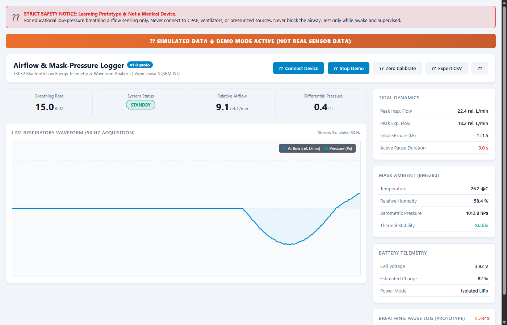

# Breathing Airflow and Mask-Pressure Logger (learning prototype)

[](LICENSE)
[](https://www.arduino.cc/)
[](https://www.espressif.com/en/products/socs/esp32)
[](https://platformio.org/)

An open-source, modular embedded system prototype built on the **ESP32** microcontroller to measure respiratory airflow dynamics, estimate tidal breathing rate, monitor absolute mask/enclosure environment, and transmit live telemetry via Bluetooth Low Energy (BLE) to a web-based dashboard.

Developed as a student learning prototype by **Vigneshwar S**, 2nd-year Electronics and Communication Engineering (ECE) student at **SRM Institute of Science and Technology**.

---

## ?? Important Safety Rules & Non-Medical Disclaimer

> [!CAUTION]
> ### STRICT SAFETY WARNING & DISCLAIMER
> - **NOT A MEDICAL DEVICE**: This project is an educational, non-clinical student engineering experiment created strictly for developing hands-on skills in analog signal conditioning, differential pressure measurement, digital signal filtering, and BLE communication.
> - **NO DIAGNOSTIC OR THERAPEUTIC CLAIMS**: This project does NOT diagnose, treat, mitigate, or monitor sleep apnea, hypopnea, respiratory distress, or any pathological medical condition. It must never be used as a life-safety monitor, clinical alarm, or diagnostic instrument. The feature tracking flow cessation is strictly designated as a **"breathing pause alert (prototype)"**.
> - **LOW-PRESSURE SENSING ONLY**: Never connect this device to CPAP machines, BiPAP units, mechanical ventilators, compressed air tanks, or any pressurized medical equipment.
> - **UNRESTRICTED OPEN AIRWAY**: Never block, occlude, or seal the airway. The sensing path must always allow free, unhindered breathing (e.g., an open-ended tube held near the nose or an open-vent mask cup).
> - **AWAKE & SUPERVISED TESTING ONLY**: Perform all tests exclusively while awake, seated, and with a secondary observer present. Never test during unmonitored sleep.
> - **ELECTRICAL SAFETY**: Never wear or operate the electronics near the face while connected to mains power or actively charging via USB. Run the prototype strictly from isolated battery power during face proximity.

---

## Dashboard Preview

The web dashboard is a single self-contained HTML/JS application utilizing the modern Web Bluetooth API. It provides real-time canvas waveform graphing, live physiological metrics, pause event logging, and CSV data export without requiring external libraries or build tools.

<!-- Dashboard Screenshot Embed -->

*Figure 1: Dashboard running in demo mode with simulated data (SIMULATED DATA banner active).*

<!-- Real Hardware Screenshot Placeholder: 
Once physical hardware bench testing is completed, replace or supplement with:

*Figure 2: Dashboard running on live ESP32 hardware streaming physical sensor data.*
-->

---

## Project Status Checklist

- [x] **Phase 1: Architecture & Repository Setup**
  - [x] Complete directory tree, PlatformIO configuration, dual MIT / CC BY 4.0 licensing.
  - [x] Hardware documentation: pin table, Mermaid wiring diagram, BOM with Indian market pricing.
  - [x] Mechanical flow restrictor design and 3D printing guide.
  - [x] Custom KiCad 2-layer PCB design guidelines.
  - [x] Engineering design notes, calibration protocol, test plan, and blank results templates.
- [ ] **Phase 2: Firmware Implementation** (In progress / Next)
  - [ ] 50 Hz ADS1115 differential pressure sensor sampling.
  - [ ] Startup zero-offset calibration and baseline drift correction.
  - [ ] Breathing analysis state machine (BPM, peak flow, I:E ratio).
  - [ ] Breathing pause alert (prototype) logic with sensor disconnect fault check.
  - [ ] 1 Hz BME280 environmental acquisition and battery voltage monitor.
  - [ ] BLE custom GATT server with notify characteristics.
  - [ ] Demo mode (simulated breathing with pause injection) and serial debug plotter.
- [ ] **Phase 3: Web Bluetooth Dashboard**
  - [ ] Self-contained single-file HTML/CSS/JS dashboard.
  - [ ] Real-time HTML5 Canvas scrolling waveform graph.
  - [ ] Breathing pause timeline and statistics.
  - [ ] Step-by-step zero calibration assistant.
  - [ ] Session CSV recording and export.
- [ ] **Phase 4: Automated Testing & Validation**
  - [ ] Unit tests for breathing analysis algorithm on synthetic waveforms.
  - [ ] Browser screenshot capture in light and dark mode.
- [ ] **Phase 5: GitHub Publication**
  - [ ] Clean Git commit history, remote repository push, and community documentation.

---

## Key Features

1. **Precision Differential Airflow Measurement**:
   - Measures bidirectional pressure drop ($\pm 2.0\text{ kPa}$) across a low-resistance restrictor using an NXP MPXV7002DP piezoresistive sensor.
   - Sampled with 16-bit resolution via an ADS1115 precision ADC over I2C.
2. **Digital Signal Processing Pipeline**:
   - Single-pole IIR low-pass filtering ($f_c = 4.0\text{ Hz}$) to eliminate high-frequency turbulence and motor noise.
   - Dynamic baseline drift tracking to compensate for slow thermal shifts.
   - Non-linear flow conversion: $Q(t) = k \cdot \text{sgn}(\Delta P) \cdot \sqrt{|\Delta P|}$.
3. **Breathing Pattern Analysis**:
   - Hysteresis-based zero-crossing detection for inspiratory/expiratory phase identification.
   - Rolling 60-second window for breaths-per-minute (BPM) calculation.
   - Calculation of relative peak flow and inspiratory-to-expiratory (I:E) time ratio.
4. **Breathing Pause Alert (Prototype)**:
   - Identifies prolonged flow cessation exceeding configurable threshold (default: 10 s).
   - Discriminate between biological pauses and hardware faults (disconnected sensor or open ADC line).
5. **Secondary Environmental & Battery Telemetry**:
   - Bosch BME280 sensor reads ambient enclosure barometric pressure, temperature, and relative humidity at 1 Hz.
   - Integrated battery voltage divider with low-battery warning flag.
6. **Zero-Install Web Bluetooth Dashboard**:
   - Operates in Google Chrome on Windows, macOS, Linux, and Android smartphones without installing native apps.

---

## Hardware Overview & Wiring Summary

### Bill of Materials Summary
| Part | Specification | Est. Price (INR) | Role |
| :--- | :--- | :---: | :--- |
| **ESP32-WROOM-32** | 240MHz Xtensa, BLE 4.2 | ?380 - ?450 | Primary processing & BLE server |
| **MPXV7002DP** | Analog $\pm 2\text{ kPa}$ differential sensor | ?1,250 - ?1,650 | Measures pressure drop across restrictor |
| **ADS1115** | 16-bit precision ADC (I2C: 0x48) | ?180 - ?240 | High-resolution analog acquisition |
| **BME280** | I2C (0x76): Temp, Humid, Baro | ?280 - ?350 | Secondary environmental cross-check |
| **TP4056 + 1S LiPo** | 3.7V 800-1200mAh pouch cell | ?320 - ?440 | Portable, isolated power |
| **Passives & Tubing** | Dividers, decoupling, silicone tube | ?150 - ?250 | Interconnects and pneumatics |

For full sourcing details (including Ritchie Street Chennai and Robu.in notes), refer to [hardware/bom.md](hardware/bom.md).

### Wiring Map
- **I2C Bus**: ESP32 GPIO 21 (SDA) & GPIO 22 (SCL) $\rightarrow$ ADS1115 & BME280 (with 4.7k pull-ups to 3.3V).
- **MPXV7002DP**: Powered from 5V rail; Vout connected to ADS1115 A0 via a 10k/15k passive divider (0.6x attenuation to protect 3.3V ADC).
- **Battery Sense**: LiPo (+) connected to ESP32 GPIO 34 via 100k/100k divider with 100nF filtering cap.
- **Status LED**: ESP32 GPIO 2 (active high).

Detailed schematic diagram and pin tables are available in [hardware/wiring.md](hardware/wiring.md).

---

## Build, Flash, and Operation

### Toolchain Prerequisites
- [PlatformIO Core](https://platformio.org/) or [VS Code PlatformIO IDE Extension](https://marketplace.visualstudio.com/items?itemName=platformio.platformio-ide)
- Google Chrome or Chromium browser supporting Web Bluetooth API (`chrome://flags/#enable-web-bluetooth`)

### Compiling and Flashing Firmware
```bash
# Clone the repository
git clone https://github.com/<your-username>/airflow-pressure-logger-esp32.git
cd airflow-pressure-logger-esp32

# Build the firmware
pio run -e esp32dev

# Upload firmware to ESP32 (connect board via USB)
pio run -e esp32dev --target upload

# Open serial monitor (115200 baud)
pio device monitor -b 115200
```

### Running the Web Dashboard
1. Open Google Chrome on your PC, Mac, or Android smartphone.
2. Open `dashboard/index.html` directly in the browser (or host it locally using `python -m http.server 8000`).
3. Click **Connect Device** and select **Airflow-Logger-ESP32** from the Bluetooth pairing prompt.
4. Watch the live breathing waveform and metrics stream in real time.

---

## Running Automated Tests
```bash
# Execute native test suite for breathing algorithm
pio test -e native
# (Or run the synthetic data verification script)
python firmware/test/test_breathing_algorithm.py
```

---

## Repository Structure
```
airflow-pressure-logger-esp32/
+-- README.md               # Main project documentation and overview
+-- LICENSE                 # Dual license: MIT (code) & CC BY 4.0 (docs)
+-- .gitignore              # PlatformIO, KiCad, and OS ignore patterns
+-- platformio.ini          # PlatformIO build configuration
+-- firmware/
¦   +-- src/                # Modular C++ firmware source
¦   ¦   +-- main.cpp        # Setup, main loop, and task dispatching
¦   ¦   +-- config.h        # Central configuration, pins, and algorithm thresholds
¦   ¦   +-- airflow.h/.cpp  # MPXV7002DP + ADS1115 sampling and IIR filtering
¦   ¦   +-- breathing.h/.cpp# Phase detection, BPM, pause alert state machine
¦   ¦   +-- bme280_reader.h/.cpp # Environmental secondary data reader
¦   ¦   +-- ble_service.h/.cpp   # BLE GATT server and notification characteristics
¦   ¦   +-- battery.h/.cpp  # Battery divider voltage reader & state of charge
¦   ¦   +-- logger.h/.cpp   # Serial CSV telemetry and plotter output
¦   +-- test/               # Unit test suites on synthetic and recorded waveforms
+-- dashboard/
¦   +-- index.html          # Self-contained Web Bluetooth dashboard (HTML/CSS/JS)
+-- hardware/
¦   +-- wiring.md           # Pin tables and Mermaid circuit diagram
¦   +-- bom.md              # Bill of Materials, Indian sourcing, and sensor physics
¦   +-- flow-restrictor.md  # 3D printable mechanical tube design & calibration
¦   +-- pcb-notes.md        # Layout rules for custom 2-layer KiCad PCB
+-- docs/
    +-- design-notes.md     # Fluid mechanics, algorithms, BLE packets, and power
    +-- calibration.md      # Zero-point and volume calibration procedures
    +-- test-plan.md        # Awake supervised test protocols
    +-- results.md          # Blank verification templates (Honesty Rules)
    +-- images/             # Diagrams, demo captures, and photos
```

---

## Academic Author & Acknowledgments

- **Author**: Vigneshwar S
- **Academic Standing**: 2nd-year B.Tech in Electronics and Communication Engineering (ECE)
- **Institution**: SRM Institute of Science and Technology, Kattankulathur, Chennai, India
- **Areas of Interest**: Embedded Systems, PCB Design (KiCad), Biomedical Instrumentation, Low-Power IoT

---

## License
- **Firmware, Software & Web Dashboard**: Licensed under the [MIT License](LICENSE).
- **Hardware Documentation, Schematics & Guides**: Licensed under [Creative Commons Attribution 4.0 International (CC BY 4.0)](https://creativecommons.org/licenses/by/4.0/).
