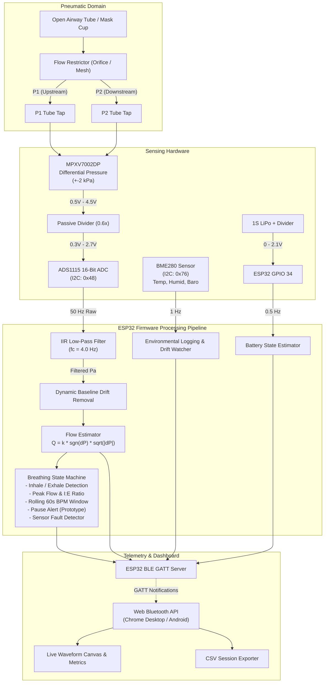

# Engineering Design Notes & System Architecture

## 1. System Overview & Block Diagram

The **Breathing Airflow and Mask-Pressure Logger** is an educational embedded system designed to capture respiratory dynamics, extract physiological timing metrics, detect breathing pauses, and stream live waveforms to a browser-based dashboard via Bluetooth Low Energy (BLE).

---

## 2. Fluid Physics of Differential Pressure Airflow

### Bernoulli Relation Across an Orifice
When air of mass density $\rho$ flows through a constriction, its velocity increases, creating a drop in static pressure:
$$\Delta P = P_1 - P_2 = \frac{1}{2} \rho (v_2^2 - v_1^2)$$

By continuity ($Q = A_1 v_1 = A_2 v_2$) and incorporating the empirical orifice discharge coefficient $C_d$:
$$Q = C_d A_2 \sqrt{\frac{2 \Delta P}{\rho \left(1 - \beta^4\right)}}$$
Where $\beta = d / D$ is the ratio of orifice diameter to pipe diameter.

For embedded execution, the geometric constants and gas density are consolidated into an empirical calibration factor $k$:
$$Q(t) = k \cdot \text{sgn}(\Delta P(t)) \cdot \sqrt{|\Delta P(t)|}$$

---

## 3. Firmware Signal Processing & Breathing Algorithm

### 1. IIR Low-Pass Filter
Breathing frequencies range from $0.1\text{ Hz}$ ($6\text{ BPM}$) to $0.8\text{ Hz}$ ($48\text{ BPM}$). High-frequency noise from turbulent eddies and electrical ripple is suppressed using a single-pole digital IIR filter sampled at $f_s = 50\text{ Hz}$:
$$y[n] = \alpha \cdot x[n] + (1 - \alpha) \cdot y[n-1]$$
With cutoff frequency $f_c = 4.0\text{ Hz}$:
$$\alpha = \frac{2\pi f_c \Delta t}{1 + 2\pi f_c \Delta t} \approx 0.335$$

### 2. Baseline Drift Removal
Thermal fluctuations and slow orientation changes cause slow drift in the sensor zero voltage. A slow exponential moving average tracks the baseline:
$$\text{baseline}[n] = \beta_{\text{base}} \cdot y[n] + (1 - \beta_{\text{base}}) \cdot \text{baseline}[n-1]$$
Where $\beta_{\text{base}}$ corresponds to a slow time constant ($\tau \approx 20\text{ seconds}$). The zero-corrected flow signal is:
$$y_{\text{clean}}[n] = y[n] - \text{baseline}[n]$$

### 3. Breathing Phase State Machine
To reliably detect inspiration and expiration without false triggering near zero flow, a Schmitt-trigger dual-threshold hysteresis is applied:
- **Inhalation State**: Entered when $y_{\text{clean}} < -T_{\text{breath}}$.
- **Exhalation State**: Entered when $y_{\text{clean}} > +T_{\text{breath}}$.
- **Transition Timestamp**: Each zero-crossing transition records timestamp $t_i$. The time elapsed between two consecutive identical transitions defines breath cycle duration $T_{\text{cycle}} = t_{i} - t_{i-2}$.

### 4. Rolling Window Breaths-Per-Minute (BPM)
Instantaneous breath durations are stored in a rolling buffer (capacity: 8 breath cycles). The rolling average BPM is computed as:
$$\text{BPM} = \frac{60.0}{\frac{1}{M}\sum_{k=1}^M T_{\text{cycle}}[k]}$$

### 5. Breathing Pause Alert (Prototype) Logic
- If the absolute magnitude $|y_{\text{clean}}[n]|$ remains below the low-flow threshold $T_{\text{pause}}$ continuously for longer than `PAUSE_THRESHOLD_SEC` (default: $10.0\text{ s}$), the firmware raises `STATUS_PAUSE_ALERT`.
- An event packet with pause start timestamp and current elapsed duration is emitted over BLE.
- When valid breathing motion resumes ($|y_{\text{clean}}| > T_{\text{breath}}$), the pause duration is finalized and recorded, and the status returns to `STATUS_NORMAL`.

### 6. Sensor Fault & Disconnect Discrimination
A critical requirement is that a disconnected sensor MUST NEVER be reported as a breathing pause. The firmware executes two fault detection checks:
1. **I2C Bus Communication Check**: If ADS1115 fails to acknowledge an I2C transaction, `STATUS_SENSOR_FAULT` is raised immediately.
2. **Voltage Bounds Check**: Scaled analog voltage must remain within $0.15\text{ V}$ to $2.85\text{ V}$. A floating or grounded analog line ($< 0.10\text{ V}$ or $> 3.0\text{ V}$) triggers a fault flag and suspends breathing pause detection.

---

## 4. BLE GATT Architecture & Packet Formats

### Service UUID
- **Primary Service UUID**: `0000FFF0-0000-1000-8000-00805F9B34FB`

### Characteristic UUIDs & Packet Structures

#### Characteristic 1: Live Airflow Waveform (Notify, ~20 Hz)
- **UUID**: `0000FFF1-0000-1000-8000-00805F9B34FB`
- **Payload Size**: 8 bytes (Binary, Little-Endian)
- **Byte Layout**:
  - `[0-3]` `uint32_t timestamp_ms`: Milliseconds since boot.
  - `[4-5]` `int16_t pressure_pa_x10`: Differential pressure in Pascals scaled by 10 (e.g. `125` = 12.5 Pa). Range: -20000 to +20000.
  - `[6-7]` `int16_t flow_rel_x10`: Relative airflow in L/min scaled by 10 (e.g. `-284` = -28.4 rel. L/min).

#### Characteristic 2: Breathing Summary Metrics (Notify, 1 Hz)
- **UUID**: `0000FFF2-0000-1000-8000-00805F9B34FB`
- **Payload Size**: 9 bytes (Binary, Little-Endian)
- **Byte Layout**:
  - `[0-1]` `uint16_t bpm_x10`: Rolling breaths per minute scaled by 10 (e.g. `165` = 16.5 BPM).
  - `[2-3]` `uint16_t peak_insp_flow_x10`: Peak inspiratory flow in rel. L/min * 10.
  - `[4-5]` `uint16_t peak_exp_flow_x10`: Peak expiratory flow in rel. L/min * 10.
  - `[6-7]` `uint16_t ie_ratio_x10`: Inhale-to-Exhale time ratio * 10 (e.g. `15` = 1:1.5).
  - `[8]` `uint8_t status_flags`: Bitmask of system status:
    - Bit 0: Normal breathing active
    - Bit 1: Low flow warning
    - Bit 2: Breathing pause alert active
    - Bit 3: Sensor fault / disconnected
    - Bit 4: Demo / Simulated mode flag

#### Characteristic 3: Pause Event Log (Notify, On-Event)
- **UUID**: `0000FFF3-0000-1000-8000-00805F9B34FB`
- **Payload Size**: 8 bytes (Binary, Little-Endian)
- **Byte Layout**:
  - `[0-3]` `uint32_t event_start_ms`: Timestamp when pause began.
  - `[4-7]` `uint32_t duration_ms`: Duration of pause in milliseconds (updated during pause, finalized on breath resume).

#### Characteristic 4: Environmental BME280 Data (Notify, 1 Hz)
- **UUID**: `0000FFF4-0000-1000-8000-00805F9B34FB`
- **Payload Size**: 8 bytes (Binary, Little-Endian)
- **Byte Layout**:
  - `[0-1]` `int16_t temperature_c_x100`: Temperature in °C * 100 (e.g. `2745` = 27.45 °C).
  - `[2-3]` `uint16_t humidity_rh_x100`: Relative humidity in % * 100 (e.g. `5820` = 58.20%).
  - `[4-7]` `uint32_t pressure_pa`: Absolute barometric pressure in Pa (e.g. `101325` Pa).

#### Characteristic 5: Battery Status (Notify / Read, 0.5 Hz)
- **UUID**: `0000FFF5-0000-1000-8000-00805F9B34FB`
- **Payload Size**: 4 bytes (Binary, Little-Endian)
- **Byte Layout**:
  - `[0-1]` `uint16_t millivolts`: Battery terminal voltage (e.g. `3850` = 3.85V).
  - `[2]` `uint8_t percent`: Estimated state of charge (0 to 100%).
  - `[3]` `uint8_t charging_flag`: 1 if charging, 0 if discharging.

---

## 5. Power Budget & Battery Considerations

| Subsystem | Active Current (Nominal) | Duty Cycle / Notes |
| :--- | :---: | :--- |
| ESP32 CPU (Xtensa dual-core @ 160MHz) | ~30 mA | CPU clock reduced from 240MHz to 160MHz to conserve power |
| ESP32 BLE Radio (TX power +3 dBm) | ~70 mA (during TX) | Transmit bursts occur at 20 Hz, effective average ~12 mA |
| MPXV7002DP Sensor | ~7.0 mA | Continuous analog piezoresistive bridge current |
| ADS1115 ADC | ~0.15 mA | Continuous conversion mode |
| BME280 Sensor | ~0.003 mA | Forced mode sampled at 1 Hz |
| Resistor Dividers & Passives | ~0.05 mA | 200k battery divider + 25k sensor divider |
| **Total Average Current Consumption** | **~50 mA** | |

### Estimated Battery Runtime:
For an $800\text{ mAh}$ 1S LiPo cell:
$$\text{Runtime} \approx \frac{800\text{ mAh} \times 0.85\text{ (efficiency factor)}}{50\text{ mA}} \approx 13.6\text{ Hours}$$
